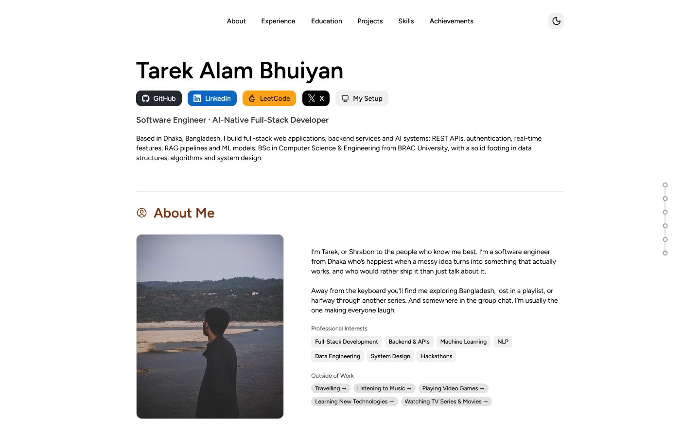
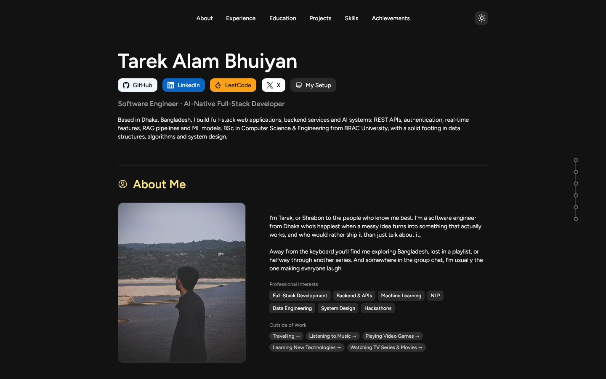
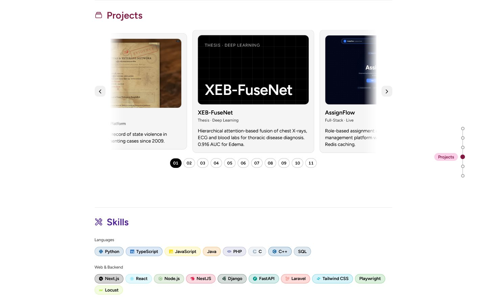
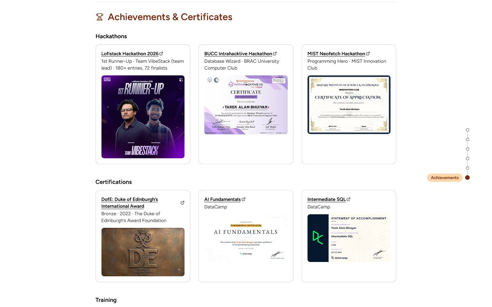
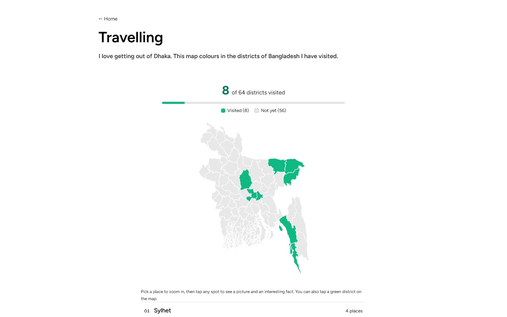
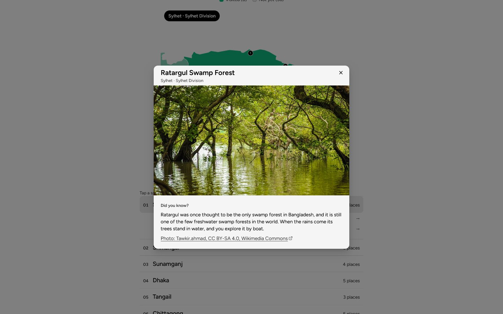
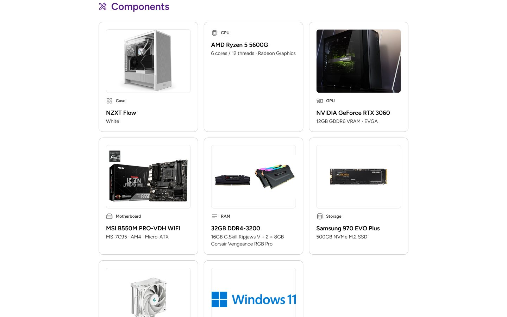
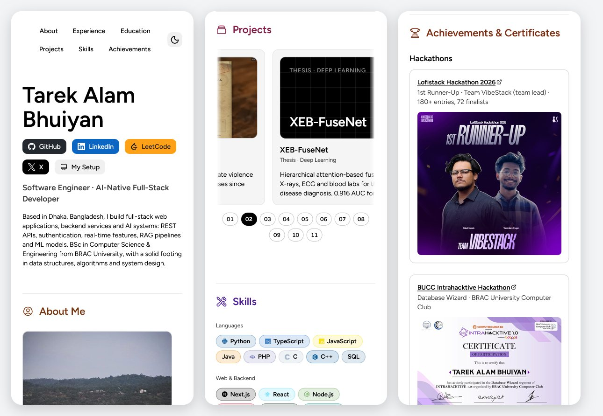

<div align="center">

# Tarek Alam Bhuiyan

### A minimal, motion-rich developer portfolio with a built-in admin

Software Engineer · AI-Native Full-Stack Developer · Dhaka, Bangladesh

<p>
  
  
  
  
  
  
</p>

 

</div>

---

## Contents

- [Highlights](#highlights)
- [Tour of the site](#tour-of-the-site)
- [Design and motion](#design-and-motion)
- [Admin](#admin)
- [Under the hood](#under-the-hood)
- [Getting started](#getting-started)
- [Configuration](#configuration)
- [API](#api)
- [Deploying](#deploying)
- [Project structure](#project-structure)
- [Credits](#credits)
- [Licence](#licence)

## Highlights

| | |
| --- | --- |
| **Everything is editable** | A password-protected `/admin` edits every piece of content (profile, projects, places, playlists, even the PC parts list) with no code changes and no database. |
| **Fits the first screen** | The name, bio and About Me are sized from the window height, so the landing view fits one screen on any laptop or desktop. Phones scroll normally. |
| **Motion with restraint** | Lenis smooth scrolling and GSAP reveals. Section icons draw themselves and titles type out as you reach them. All of it switches off under `prefers-reduced-motion`. |
| **Light and dark** | A white light mode and a near-black dark mode, both strictly monochrome apart from per-section accent colours, with a droplet animation when you switch. |
| **Light on the wire** | Interest pages and the admin load on demand, images are WebP at display size, and the main script is about 242 KB gzipped. |
| **Private visitor count** | A unique-visitor counter that stores only salted hashes of random IDs. No cookies, no personal data. |

## Tour of the site

### Home page

The single page has a top bar that links to every section and a timeline on the right edge that follows where you are.

| Section | What is in it |
| --- | --- |
| **Hero** | Name, role, short bio, and pills for GitHub, LinkedIn, LeetCode, X and **My Setup**. |
| **About Me** | Portrait, bio, professional-interest chips, and "Outside of Work" chips that open the interest pages. |
| **Experience** | Work and research roles with company logos, dates and bullet points. |
| **Education** | Degree, school and notes, with school logos. |
| **Projects** | A slider of 11 project cards that drifts right to left, pauses on hover or focus, moves a card at a time with the arrow buttons or ← / → keys, and has a numbered pager (`01`–`11`) to jump to any project. Fades out softly at both edges. |
| **Skills** | Pills in brand colours with icons, grouped into Languages, Web & Backend, AI / ML, Data & Tools and Spoken Languages. |
| **Achievements & Certificates** | A card grid split into **Hackathons**, **Certifications** and **Training**, each card with its certificate or poster image. |
| **Footer** | Call to action, the unique-visitor count and a giant wordmark whose letters rise in and lift on hover. |

<p align="center">
  
  
</p>

### Project pages

Every project has its own page at `/projects/<slug>` with an overview, highlights, a tech-stack list, and a carousel of live-page screenshots where the project is online. Each page ends with **Previous Project**, **Next Project** and **Main Page** buttons that wrap around.

### Interest pages

| Page | What is in it |
| --- | --- |
| **Travelling** `/interests/travelling` | A zoomable map of Bangladesh's 64 districts with the visited ones coloured in, a progress counter, and a list of places. Pick a place to zoom in and see its numbered spots. **Tap any spot (in the list or on the map) to open a popup** with a hero photo, an interesting fact and a photo credit. |
| **Music** `/interests/music` | Playlists. |
| **Watching** `/interests/watching` | A poster grid of movies and series with ratings. |
| **Video Games** `/interests/gaming` | Games with platform and notes. |
| **Learning** `/interests/learning` | What I am learning right now, with tags. |

<p align="center">
  
  
</p>

### My Setup

`/setup` lists the PC I build and play on, part by part: case, CPU, GPU, motherboard, RAM, storage, cooler and OS. Each part is a card with an icon, its exact model and, where available, a product photo.

<p align="center">
  
</p>

### Phones

The whole site is responsive. On phones the top bar wraps, the project slider uses the full width (swipe, with the pager to jump), spacing tightens, and the About Me photo stacks above the text.

<p align="center">
  
</p>

## Design and motion

- **Palette.** One file, `src/palette.ts`, drives the page background, cards, borders and text for light and dark. Light mode is plain white with black text (`#000` on `#fff`); dark mode is `#121212`. Each section has its own accent colour for its header and its hover state in the top bar.
- **Theme switch.** An icon button runs a droplet animation that floods the page with the next theme (adapted from [Pin UI](https://www.pinui.xyz/components/theme-switch)).
- **Smooth scroll and reveals.** [Lenis](https://lenis.darkroom.engineering/) drives scrolling from GSAP's ticker, and ScrollTrigger fades content up as it arrives.
- **Section headers.** The icon is drawn stroke by stroke and the title types out as each section scrolls into view. The first screen, which is already visible, appears at once.
- **Always starts at the top.** A refresh, the browser back button and the "Home" links all land at the very top.
- **Accessible.** Keyboard operable (the slider, the pager, popups and the map spots), focus rings, contrast above WCAG AA, labelled controls, and `prefers-reduced-motion` support.
- **Design system.** UI built from [Astryx](https://astryx.atmeta.com/docs/getting-started) components and its neutral theme. The rules live in [`DESIGN.md`](DESIGN.md).

## Admin

Open `/admin` and sign in. Visitors can only read; every change needs a signed session token.

| Collection | Edits |
| --- | --- |
| Profile, About me | Name, role, bio, links, photo, interests, hobbies |
| Experience, Education | Roles and schools, logos, dates, bullet points |
| Projects | Cards, summaries, stacks, highlights, screenshots |
| Skills | Groups and items |
| Achievements | Hackathons, certifications and training, with images and links |
| Travel places | Places, spots with coordinates, districts, facts, hero images and credits |
| Movies & series | Search as you type, poster and rating; import a Letterboxd diary |
| Playlists, Video games, Learning | Lists with notes and tags |
| My setup | PC parts with names, details and photos |

Everything has defaults in `src/content.ts`. Edits are stored on the server and loaded on top of them, and **Reset to default** removes an edit. The forms and the server-side validation both come from one file, [`shared/schema.json`](shared/schema.json): to make a new field editable, add it there.

## Under the hood

| Area | Choice |
| --- | --- |
| Framework | React 19, React Router 7, TypeScript |
| Build | Vite 8 |
| UI | Astryx components and `@astryxdesign/theme-neutral` |
| Motion | GSAP (ScrollTrigger) and Lenis |
| Icons | Heroicons and Simple Icons |
| Server | A small dependency-free Node API (`server/`) that also runs as a Vercel function |
| Storage | A JSON file, or Upstash Redis / Vercel KV for hosts without a disk |

**Performance.** The interest pages (with the 190 KB Bangladesh map) and the admin are split into chunks that load only when opened, so the main script is about 712 KB (242 KB gzipped) instead of 1.17 MB. All spot and certificate images are WebP at display size.

**Privacy and security.**

- The admin password is never stored: only a salted `scrypt` hash and a session-signing secret live in `.env` or the host's environment.
- Login attempts are rate-limited per IP, sessions expire after 12 hours, and every write is validated against the schema on the server.
- The visitor counter stores a salted SHA-256 hash of a random browser ID, never the ID itself, and allows each IP only a few new IDs an hour. The `/admin` page is not counted.

## Getting started

Requires Node 20.19 or newer.

```bash
npm install
npm run dev          # http://localhost:5173
npm run build        # type-checks, then builds to dist/
npm run preview      # serve the production build
npm start            # production server: the built site and the API in one Node process
```

Set up the admin once:

```bash
ADMIN_PASSWORD='choose a password' npm run admin:setup   # writes ADMIN_PASSWORD_HASH and ADMIN_SESSION_SECRET to .env
npm run dev                                              # then open http://localhost:5173/admin
```

## Configuration

Copy `.env.example` to `.env` (or set these in your host's environment).

| Variable | Required | Purpose |
| --- | --- | --- |
| `ADMIN_PASSWORD_HASH`, `ADMIN_SESSION_SECRET` | For the admin | Created by `npm run admin:setup`. |
| `TMDB_API_KEY` | No | Better movie and series search with posters (free key from themoviedb.org). Without it, series use TVmaze and movies use Wikipedia. |
| `UPSTASH_REDIS_REST_URL`, `UPSTASH_REDIS_REST_TOKEN` | No | Where edits and visitor counts are saved on a host without a disk (Vercel's Upstash / KV integration fills these in). Without them, data goes to `data/` on disk. |
| `CONTENT_FILE` | No | Custom path for the saved edits. |
| `PORT` | No | Port for `npm start` (default 3000). |

## API

| Method and path | Access | Purpose |
| --- | --- | --- |
| `GET /api/content` | Public | Edited content. |
| `POST /api/visit` | Public | Counts a unique visitor (`{id}`); returns the total. |
| `GET /api/visitors` | Public | The unique-visitor count. |
| `POST /api/login` | Public | `{password}` → `{token}`. |
| `GET /api/session` | Token | Checks a token. |
| `PUT /api/content/:name` | Token | Saves a collection. |
| `DELETE /api/content/:name` | Token | Resets a collection to its default. |
| `GET /api/search?type=&q=` | Token | Movie or series search. |
| `GET /api/letterboxd?user=` | Token | Imports a Letterboxd diary from its public RSS feed. |

## Deploying

The admin needs a server, so the site cannot be hosted as static files alone.

- **Vercel.** Import the repo, set `ADMIN_PASSWORD_HASH` and `ADMIN_SESSION_SECRET`, and add an Upstash Redis (or Vercel KV) store so edits and the visitor count persist. `api/[...path].js` serves the API and `vercel.json` rewrites everything else to the app.
- **Any Node host with a persistent disk.** `npm run build && npm start`.

## Project structure

```
src/
  App.tsx, main.tsx          routes, theme, layout, on-demand page loading
  pages/                     Home, ProjectPage, Interests (travel, music, watching, games, learning), Setup, shell
  admin/                     the /admin screen (generic form editor, movie search)
  content.ts                 built-in content        remote.ts   loads saved edits on top
  palette.ts, theme.ts       page colours and the Astryx theme
  motion.ts                  Lenis + GSAP setup, scroll reveals, section-header effects
  ProjectSlider.tsx          the drifting project slider and its numbered pager
  Footer.tsx, SectionRail.tsx, ThemeToggle.tsx, visitors.ts
  theme-rain/                the theme-change animation engine
  bd-map.ts                  the 64 district shapes (generated)
server/                      API core, storage (file or Redis), adapters, production server
api/                         Vercel function
shared/schema.json           the editable-content schema used by the admin and the server
public/                      images, logos, certificates, place and part photos
docs/screenshots/            the pictures in this README
```

`CLAUDE.md`, `AGENTS.md` and `DESIGN.md` describe the design rules and how AI coding agents should work in this repository.

## Credits

- UI components and theme: [Astryx](https://github.com/meta/astryx) (Meta). Brand icons from [Simple Icons](https://simpleicons.org/), other icons from Heroicons.
- The theme-change animation is adapted from the Theme Switch component by [Pin UI](https://www.pinui.xyz/components/theme-switch) (see the header of `src/theme-rain/engine.ts`).
- The district map was inspired by [Unseen Bangladesh](https://unseenbd.com/). Its outlines are simplified from administrative boundary data used in the AVN project; check the data provider's licence (GADM is free for non-commercial use) before reusing them.
- Photos in the Travelling popups come from [Wikimedia Commons](https://commons.wikimedia.org/) under free licences (CC BY, CC BY-SA, CC0). Each popup shows the author and licence and links to the file page. The facts are drawn from Wikipedia.
- Movie and series data comes from TVmaze, Wikipedia, TMDB (optional) and Letterboxd's public feed.
- Company, school, certificate and product logos and photos (including the My Setup product images) belong to their owners and are shown to describe my work, education and equipment.

## Licence

This is a personal site. The code and content are not licensed for reuse (all rights reserved), except for the third-party parts credited above, which keep their own licences.
